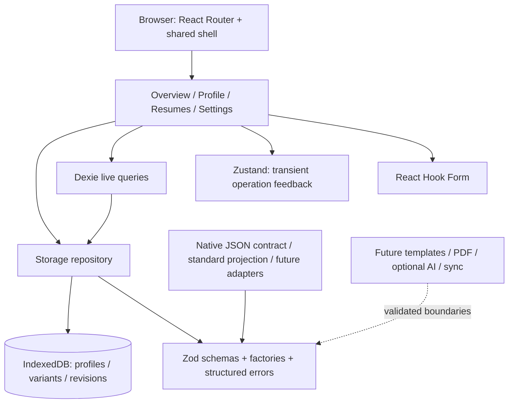

# Architecture

## Application and boundaries

A single client-rendered React application built by Vite. There is no server runtime or required backend. React Router uses a shared shell for `/`, `/profile`, `/resumes`, `/settings`, and `*`. The shell owns navigation, focus-on-navigation, title updates, and live notifications. A route-keyed error boundary preserves navigation after a page failure; an outer boundary handles shell-level failures. No error handler clears records.

`src/domain` is independent of React and database code. It owns schemas, domain types, IDs, date validation, factories, template contracts, and source-resolution policy. `src/services/storage` manages transactions and database errors. `src/features` contains actual workflows, not alternate domain models. `src/components/ui` owns reusable controls using shadcn/Radix conventions; layout components own the shell and page hierarchy. Synthetic fixtures live exclusively in `src/data`.

## State management

IndexedDB is the sole persisted source of candidate records. `dexie-react-hooks` observes read transactions; components receive a validated consistent pair of profile/variant lists through context. No record cache is duplicated in Zustand or localStorage. The Zustand store holds only pending-operation state and an accessible success/error notice. React Hook Form owns ephemeral form inputs. Multiple tabs receive database change notifications through Dexie; optimistic timestamp checks reject stale record updates.

## Persistence and integrity

Dexie database version 1 has profiles (`id`, `updatedAt`), variants (`id`, `sourceProfileId`, `updatedAt`), and revisions (`id`, `variantId`, `createdAt`). Reads and writes validate records. Unknown/future schema versions raise structured errors. An invalid record blocks the affected view while its bytes remain stored for future recovery; Stage 0 has no recovery/export UI.

Demo creation writes a profile and variant atomically. Demo deletion atomically removes sample profiles plus their variants and revisions. Individual profile deletion is blocked while linked variants exist. Individual variant deletion removes its revisions in the same transaction. Profile/variant metadata saves compare the current `updatedAt`, preserve immutable creation/source metadata, and generate a strictly increasing timestamp. Variant saves snapshot the previous variant and prune history to 20 in the same transaction. Transaction failures roll back all affected writes.

Errors distinguish missing records, unsupported versions, invalid data, unsupported references, conflicts, quota exhaustion, storage unavailability, and generic storage failures. Custom errors use the name `StudioDataError` to avoid Dexie's mapping of native IndexedDB `DataError` names.

## Content and design

A profile is source evidence. A variant pins selected entries and summary, references the source profile, and carries explicit ordering plus isolated wording overrides. The template is a validated value object of bounded numbers and enums. There are no CSS expressions or executable fields. Template config is preparatory; no renderer is implied by a template ID. See [data model](DATA_MODEL.md) for reference and drift rules.

## Portability

Native backup serialization validates profiles, variants, revisions, uniqueness, and relationships. Parsing is limited to 5 MiB and produces an in-memory value only. Standard JSON Resume projection is deliberately limited and lossy; it exports a profile, not a fully resolved variant, and returns warnings. Contract tests validate emitted JSON using the maintained schema package. YAML has a typed envelope but no parser or serializer yet.

Future imports must parse into a detached proposal, validate schema/references/limits, generate a diff, and require explicit acceptance before a transactional write. Keep the original valid copy. Never evaluate HTML, YAML tags, JavaScript, template source, or configuration supplied by an imported file.

## Future integrations

| Integration           | Extension boundary                                                                                                                                         |
| --------------------- | ---------------------------------------------------------------------------------------------------------------------------------------------------------- |
| React PDF             | Resolve a validated variant into a pure render model; PDF and HTML preview consume the same model. It must not write profile data.                         |
| JSON Resume           | Add bidirectional mapping, schema validation, loss reporting, and variant resolution around `services/interoperability`.                                   |
| YAML                  | Add safe bounded plain-data parsing/serialization for the declared envelope; reject custom tags/alias expansion abuse.                                     |
| dnd-kit               | UI reordering persists stable section/entry identifiers, never array-index identity.                                                                       |
| WebLLM                | Optional local provider consuming explicitly selected evidence and returning validated suggestions. Budget model download/memory and provide cancellation. |
| Cloudflare Workers AI | Future optional network adapter, explicit consent, backend-held credentials, minimal payloads, and a non-AI fallback. No key in a Vite bundle.             |
| Supabase sync         | Future opt-in repository synchronization layer with ownership, conflict handling, deletion semantics, and local-first fallback. No auth dependency today.  |

Do not install these roadmap libraries until needed. Suggestions must record provider/model/evidence provenance and require acceptance before becoming variant wording. Source profiles are never changed automatically.

## Privacy and security

Candidate data is never uploaded by implemented workflows. There is no analytics, tracking pixel, advertisement, remote font, AI request, authentication, or environment secret. React escapes rendered text; links must validate as HTTP(S) and external links use `noreferrer`. Production static `_headers` supplies CSP, MIME sniffing protection, referrer privacy, and disabled device capabilities. `style-src 'unsafe-inline'` permits Radix's runtime style attributes; scripts remain self-origin without eval/inline permission. Hosting headers must be rechecked on a future real deployment.

IndexedDB is origin/browser-profile scoped, not an encrypted vault or backup. A compromised same-origin script, browser extension, shared browser profile, or compromised device can expose records. Clearing storage, eviction, and private mode affect retention. Development tooling/downloads and external documentation links use the network; candidate workflows do not. The browser test checks no outbound requests during normal use.

## Zero-cost deployment

`dist/` is the static output. `wrangler.jsonc` uses assets-only Workers hosting with SPA fallback and no backend script. Hosting accounts are unnecessary for local development. Stage 0 prepares the config and documents future deployment; it does not create Cloudflare resources. See [deployment](DEPLOYMENT.md).
