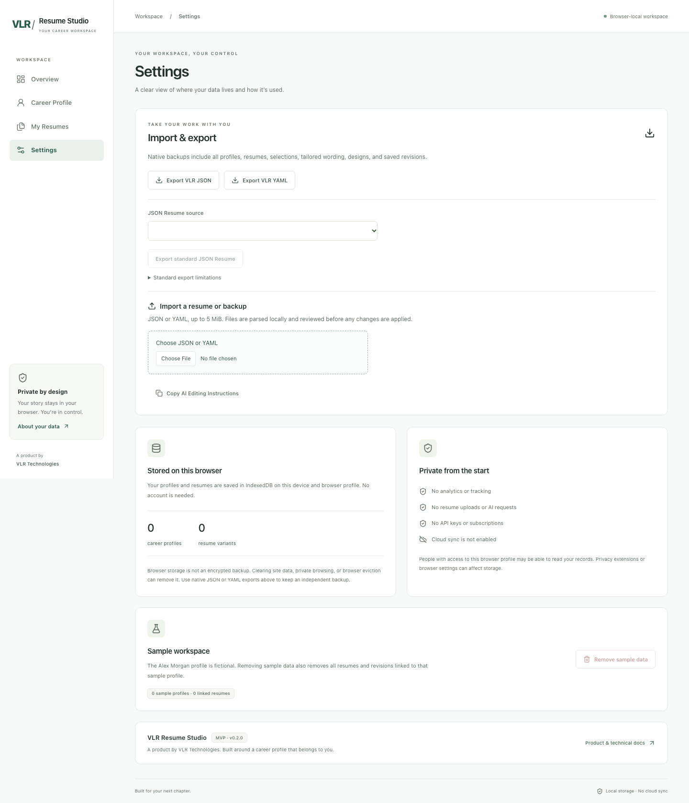
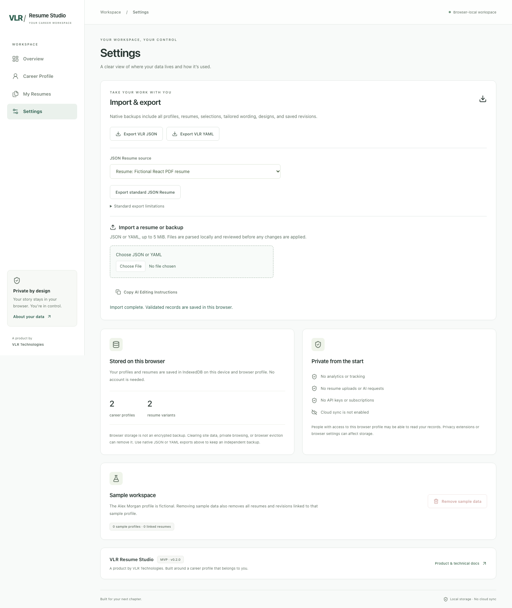

# Settings Runtime Crash Investigation & Fix Report

Date: 2026-10-27  
Branch: `fix/settings-runtime-crash`  
Base: fetched `origin/main` (`562ce85`, PR #3 merged)

## Finding and exception

The reported error boundary could not be reproduced. No JavaScript exception or stack trace was emitted in the verified production runs, so there is no exact exception to report. The report supplied the error-boundary copy but no browser console output, stack trace, failing request, or specific workspace backup.

The investigated Settings path lazily loads `PortabilityPanel`. Before this change, that panel ran the selected profile or resume's JSON Resume projection during render. Projection validates and maps profile data. This was an unnecessary synchronous dependency of the initial Settings render and could let an exception in an optional export path escape into the page boundary. This is a risk found by source inspection; it was not observed as the cause of the reported incident.

## Reproduction evidence

The tests ran against the Vite production build with production preview headers and fresh Playwright browser contexts. The regression test visited Settings through sidebar navigation and a direct `/settings` URL, then refreshed the direct URL. It also imported fictional data containing two profiles, a React PDF variant, a Typst v2 variant, Unicode names, and optional empty fields; refreshed Settings; and exported standard JSON Resume.

For every run, the test monitored `pageerror`, browser console errors, failed same-origin requests, same-origin HTTP errors, and the error-boundary heading. It found none. Screenshots are included below.

| Workspace / route                                         | Chromium desktop | Chromium mobile | Firefox | WebKit |
| --------------------------------------------------------- | ---------------- | --------------- | ------- | ------ |
| Empty; sidebar navigation, `/settings`, refresh           | Pass             | Pass            | Pass    | Pass   |
| Imported React PDF + Typst v2; reload and standard export | Pass             | Pass            | Pass    | Pass   |

The full production E2E suite also passed its existing scenarios for native JSON/YAML backups, standard JSON Resume, reviewed import and cancellation, new-record import, safe merge, replace with recovery backup, invalid input, sample removal, dialogs and focus, AI editing instructions, revision history, legacy React PDF templates, Typst templates, direct routes, and effective CSP/COOP/COEP headers.

### Screenshots

## Change made

- Moved JSON Resume projection out of render and into the explicit export button action. Opening Settings no longer projects or validates a profile merely to render optional export controls.
- Kept export validation intact. Projection or download errors are shown in the portability panel's existing alert area, including `DataError` details; errors are not swallowed.
- Kept the JSON Resume export action available when a profile exists and retained existing limitation warnings, updating them after a successful projection.
- Changed Product & Technical Docs to link to the stable `main/docs` path.
- Added `e2e/settings-runtime.spec.ts`, which fails if the boundary appears or runtime exceptions, console errors, or same-origin asset failures occur, and captures screenshots for both workspace shapes.

This change isolates an optional operation and its errors. Because the original crash was not reproduced, it does not establish that projection caused the reported production incident.

## Data safety

All browser runs used Playwright-created isolated contexts and fictional fixtures. The imported test backup was reviewed and applied only to its test context. Existing user IndexedDB was not read, reset, migrated, or modified. The existing full E2E workflows verified import cancellation, safe merge, replace recovery backup, reload retention, and data preservation after invalid imports and storage failures.

## Files changed

- `src/features/portability/portability-panel.tsx`
- `src/features/settings/settings-page.tsx`
- `e2e/settings-runtime.spec.ts`
- `docs/qa/SETTINGS_CRASH_FIX_REPORT.md`
- `docs/qa/evidence/settings-empty-workspace.png`
- `docs/qa/evidence/settings-react-pdf-and-typst.png`

## Verification results

- `npm run lint` — passed.
- `npm run typecheck` — passed.
- `npm run format:check` — passed.
- `npm test` — 318 passed across 12 files.
- `npm run build` — passed. The existing large-chunk advisory for the Typst WASM/PDF assets remains.
- `npm run test:e2e` — 152 passed across Chromium desktop, Chromium mobile, Firefox, and WebKit (38 cases per project); no failures or skips.
- Focused Settings regression — 8 passed across those four projects.
- `npm audit --audit-level=moderate` — 0 vulnerabilities.
- `git diff --check` — passed.

The sandbox initially blocked the preview server and npm audit registry requests. Browser tests were rerun with localhost access; the audit was rerun with registry access and returned zero vulnerabilities.

## Remaining diagnostic needed

To confirm the original incident's root cause, capture from the affected browser session:

1. The first uncaught exception's full message and JavaScript stack (DevTools Console or the app's `pageerror` equivalent), including chunk URL and source line.
2. Failed network requests and response status for scripts, dynamic imports, and generated validator modules, plus the response CSP header.
3. App build/commit, browser and version, exact navigation steps, and whether the workspace contains legacy or Typst records.
4. If data-shape-specific, a privacy-scrubbed VLR JSON/YAML backup that reproduces the failure, or a synthetic IndexedDB export with the same relevant shapes.

Without those runtime details, the incident's original exception and precise cause remain unknown.
